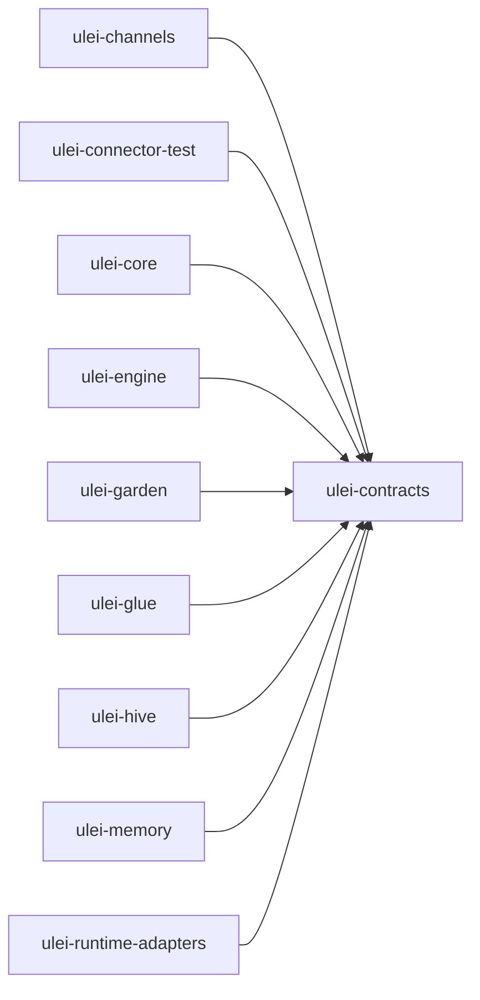

<!-- GENERATED by `cargo xtask module-map` from cargo metadata, contracts/index.json and ecosystem.lock. Do not edit by hand. -->

# Module map

Modules talk to each other only through `ulei-contracts` (types generated from `contracts/`) and the wire. Class-1 products live in their own repositories and are pinned in `ecosystem.lock`. Rules: [ADR-0001](adr/0001-cargo-workspace-and-module-classes.md).

## Crates

| Crate | Path | Class | Role | Contracts | Workspace deps | External deps |
|---|---|---|---|---|---|---|
| `ulei-channels` | `crates/channels` | 2 | Owner channels (Telegram first). | C1, C6, C9 | `ulei-contracts` | rustix, serde, serde_json, signal-hook, ureq |
| `ulei-connector-test` | `crates/connector-test` | 2 | Source connector: the stdio test connector of C11, the conformance subject of the runner's tests. | C11 | `ulei-contracts` | serde_json |
| `ulei-contracts` | `crates/contracts` | contracts | Leaf crate: generated wire types for every contract and the two decoders of C9. | — | — | serde, serde_json |
| `ulei-core` | `crates/core` | 2 | Core: inbox/events (C1), registry, config, notify fallback, MCP facade (C2), `ulei` CLI, source connectors' runner (C11). | C1, C2, C4G, C6, C9, C10, C11 | `ulei-contracts` | hmac, rusqlite, rustix, serde, serde_json, sha2 |
| `ulei-engine` | `crates/engine` | 2 | Engine: own agent loop, tools, sessions; models only through the qb gateway (ADR-0009). | C4G, C6, C7, C8, C9 | `ulei-contracts` | regex-lite, ring, rusqlite, rustix, serde_json, sha2, signal-hook, ureq |
| `ulei-garden` | `crates/garden` | 2 | Garden: typed facts with two time axes, provenance, hybrid retrieval (C7). | C1, C7, C9 | `ulei-contracts` | hmac, ort, rusqlite, rustix, serde_json, sha2, spm_precompiled |
| `ulei-glue` | `crates/glue` | 2 | Glue to class-1 products: qb (C4), gate (C5). | C1, C4, C5, C7 | `ulei-contracts` | — |
| `ulei-hive` | `crates/hive` | 2 | Hive: cards, heads, acceptance, delivery (C3). | C1, C3 | `ulei-contracts` | — |
| `ulei-memory` | `crates/memory` | 2 | Memory below the garden: the archive of raw items (immutable, compressed, FTS5), served as C10 by `ulei-memory serve`, and later the forest made from it. | C6, C10 | `ulei-contracts` | miniz_oxide, rusqlite, rustix, serde_json, sha2 |
| `ulei-runtime-adapters` | `crates/runtime-adapters` | 2 | Runtime adapters (C6); the only place that knows about Hermes. | C1, C2, C6 | `ulei-contracts` | rustix, serde_json |

## Dependency graph

## Contracts

| Id | Version | Status | Kind | File | Title | Used by |
|---|---|---|---|---|---|---|
| C1 | 1.2.0 | stable | json-schema | `contracts/c1-event.schema.json` | Event (owner inbox) | `ulei-channels`, `ulei-core`, `ulei-garden`, `ulei-glue`, `ulei-hive`, `ulei-runtime-adapters` |
| C2 | 0.1.0 | draft | json-schema | `contracts/c2-mcp-tools.json` | MCP facade of the core | `ulei-core`, `ulei-runtime-adapters` |
| C3 | 0.1.0 | draft | json-schema | `contracts/c3-card-head.schema.json` | Card -> head -> report | `ulei-hive` |
| C4 | 0.2.0 | vendored | openapi | `contracts/c4-qb.openapi.json` | qb /v1 API | `ulei-glue` |
| C5 | 0.1.0 | draft | openapi | `contracts/c5-gate.openapi.json` | A2A gate owner side | `ulei-glue` |
| C6 | 0.9.0 | draft | json-schema | `contracts/c6-runtime-adapter.schema.json` | Runtime adapter | `ulei-channels`, `ulei-core`, `ulei-engine`, `ulei-memory`, `ulei-runtime-adapters` |
| C7 | 0.7.0 | draft | json-schema | `contracts/c7-garden.schema.json` | Garden | `ulei-engine`, `ulei-garden`, `ulei-glue` |
| C8 | 0.8.0 | draft | json-schema | `contracts/c8-session-journal.schema.json` | Session journal | `ulei-engine` |
| C9 | 0.7.0 | draft | json-schema | `contracts/c9-ulei-toml.schema.json` | ulei.toml | `ulei-channels`, `ulei-core`, `ulei-engine`, `ulei-garden` |
| C10 | 0.2.0 | draft | json-schema | `contracts/c10-archive.schema.json` | Archive | `ulei-core`, `ulei-memory` |
| C11 | 0.1.0 | draft | json-schema | `contracts/c11-connector.schema.json` | Source connector | `ulei-connector-test`, `ulei-core` |
| C4G | 1.0.0 | vendored | openapi | `contracts/c4g-qb-gateway.openapi.json` | qb model gateway | `ulei-core`, `ulei-engine` |

## Class-1 products (ecosystem.lock)

| Product | Repository | Version | Pin | Contract |
|---|---|---|---|---|
| qb | https://github.com/pasekahq/quota-balancer | 0.0.1 | `bd174f401b20` | C4, C4G |
