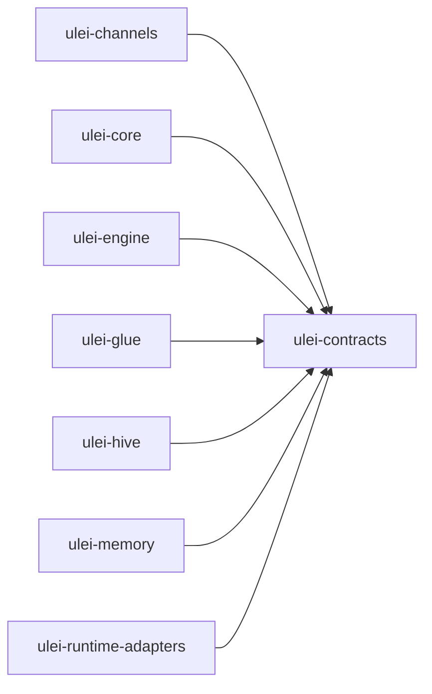

<!-- GENERATED by `cargo xtask module-map` from cargo metadata, contracts/index.json and ecosystem.lock. Do not edit by hand. -->

# Module map

Modules talk to each other only through `ulei-contracts` (types generated from `contracts/`) and the wire. Class-1 products live in their own repositories and are pinned in `ecosystem.lock`. Rules: [ADR-0001](adr/0001-cargo-workspace-and-module-classes.md).

## Crates

| Crate | Path | Class | Role | Contracts | Workspace deps | External deps |
|---|---|---|---|---|---|---|
| `ulei-channels` | `crates/channels` | 2 | Owner channels (Telegram first). | C1, C6 | `ulei-contracts` | rustix, serde, serde_json, signal-hook, ureq |
| `ulei-contracts` | `crates/contracts` | contracts | Leaf crate: generated wire types for every contract. | — | — | serde, serde_json |
| `ulei-core` | `crates/core` | 2 | Core: inbox/events (C1), registry, config, notify fallback, MCP facade (C2), `ulei` CLI. | C1, C2 | `ulei-contracts` | hmac, rusqlite, rustix, serde, serde_json, sha2 |
| `ulei-engine` | `crates/engine` | 2 | Engine: own agent loop, tools, sessions; models only through the qb gateway (ADR-0009). | C4G, C6, C8 | `ulei-contracts` | regex-lite, ring, rusqlite, rustix, serde_json, sha2, signal-hook, ureq |
| `ulei-glue` | `crates/glue` | 2 | Glue to class-1 products: qb (C4), gate (C5). | C1, C4, C5, C7 | `ulei-contracts` | — |
| `ulei-hive` | `crates/hive` | 2 | Hive: cards, heads, acceptance, delivery (C3). | C1, C3 | `ulei-contracts` | — |
| `ulei-memory` | `crates/memory` | 2 | Memory: garden + retrieval + forest (C7). | C1, C7 | `ulei-contracts` | — |
| `ulei-runtime-adapters` | `crates/runtime-adapters` | 2 | Runtime adapters (C6); the only place that knows about Hermes. | C1, C2, C6 | `ulei-contracts` | rustix, serde_json |

## Dependency graph

## Contracts

| Id | Version | Status | Kind | File | Title | Used by |
|---|---|---|---|---|---|---|
| C1 | 1.1.1 | stable | json-schema | `contracts/c1-event.schema.json` | Event (owner inbox) | `ulei-channels`, `ulei-core`, `ulei-glue`, `ulei-hive`, `ulei-memory`, `ulei-runtime-adapters` |
| C2 | 0.1.0 | draft | json-schema | `contracts/c2-mcp-tools.json` | MCP facade of the core | `ulei-core`, `ulei-runtime-adapters` |
| C3 | 0.1.0 | draft | json-schema | `contracts/c3-card-head.schema.json` | Card -> head -> report | `ulei-hive` |
| C4 | 0.0.1 | vendored | openapi | `contracts/c4-qb.openapi.json` | qb /v1 API | `ulei-glue` |
| C5 | 0.1.0 | draft | openapi | `contracts/c5-gate.openapi.json` | A2A gate owner side | `ulei-glue` |
| C6 | 0.5.0 | draft | json-schema | `contracts/c6-runtime-adapter.schema.json` | Runtime adapter | `ulei-channels`, `ulei-engine`, `ulei-runtime-adapters` |
| C7 | 0.1.0 | draft | json-schema | `contracts/c7-garden.schema.json` | Garden | `ulei-glue`, `ulei-memory` |
| C8 | 0.4.0 | draft | json-schema | `contracts/c8-session-journal.schema.json` | Session journal | `ulei-engine` |
| C4G | 0.1.0 | draft | openapi | `contracts/c4g-qb-gateway.openapi.json` | qb model gateway | `ulei-engine` |

## Class-1 products (ecosystem.lock)

| Product | Repository | Version | Pin | Contract |
|---|---|---|---|---|
| qb | https://github.com/vladmesh/quota-balancer | 0.0.1 | `80b81c31e7bf` | C4 |
